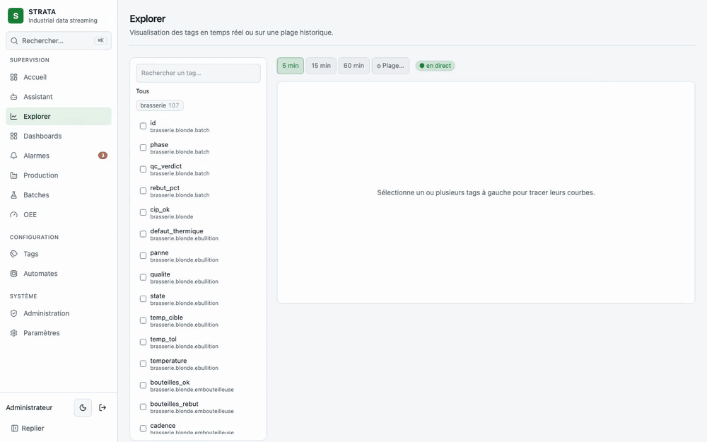
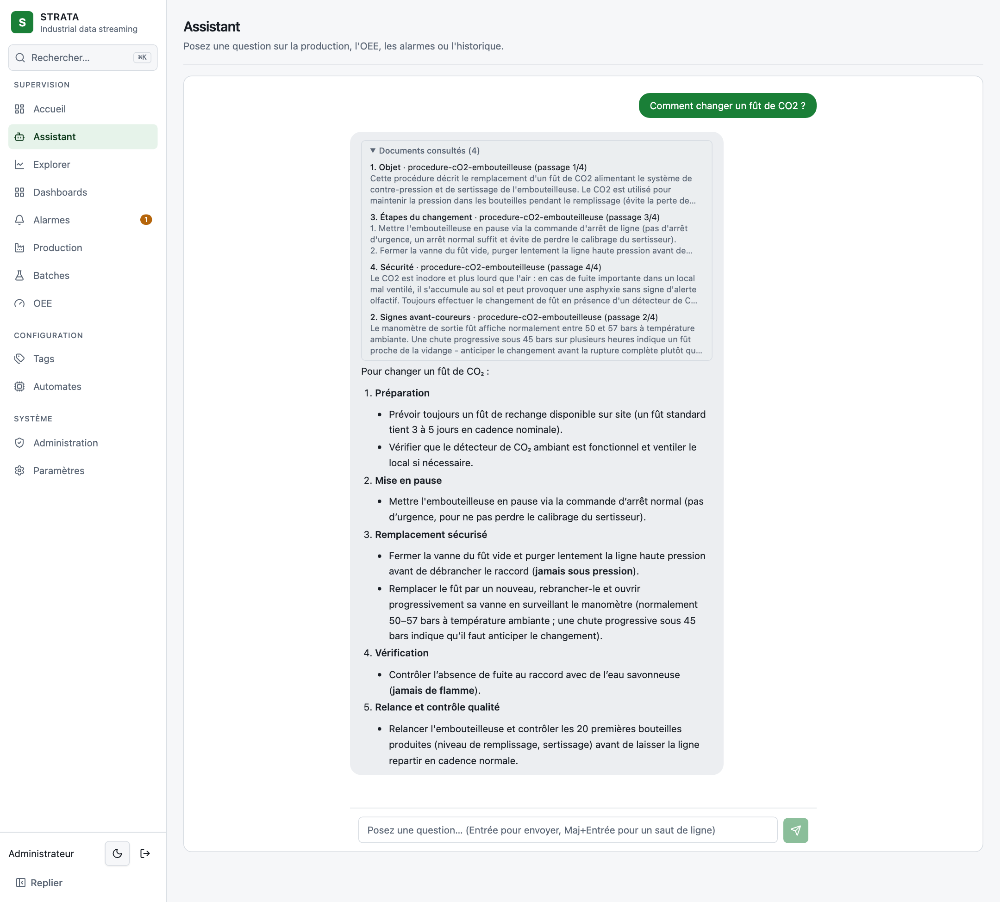
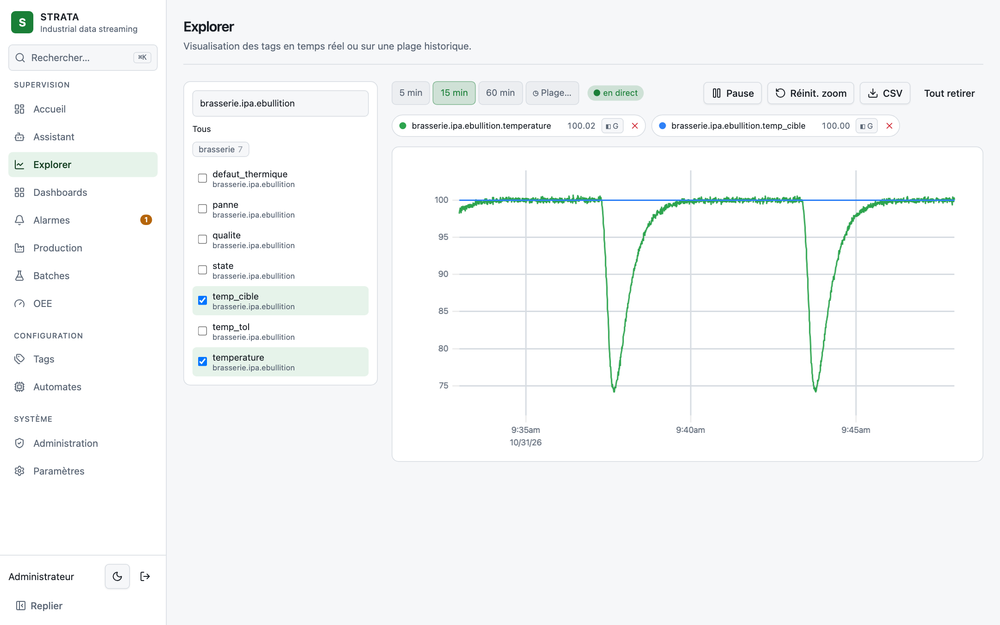
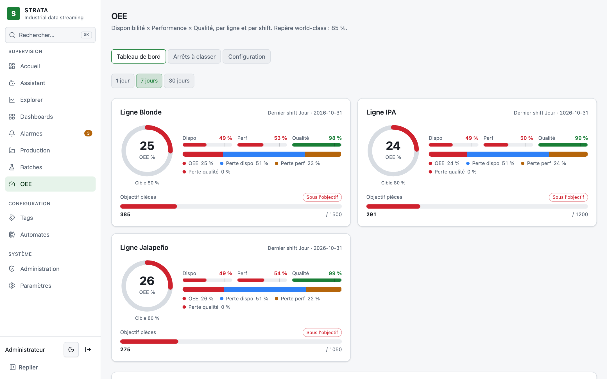
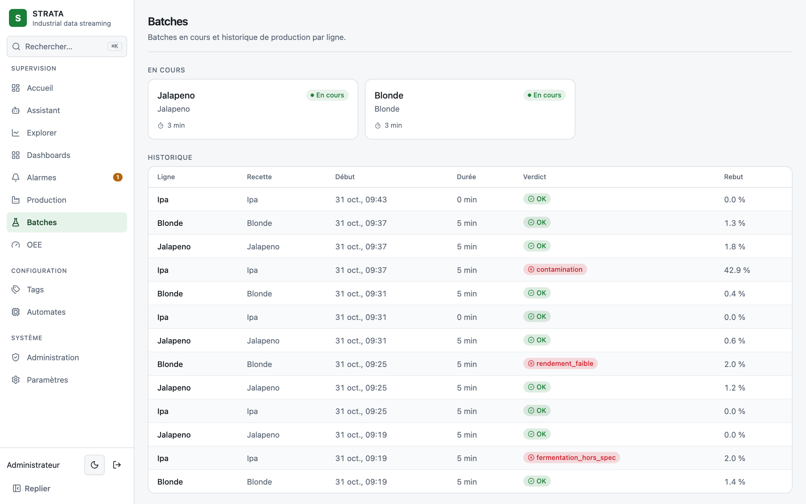
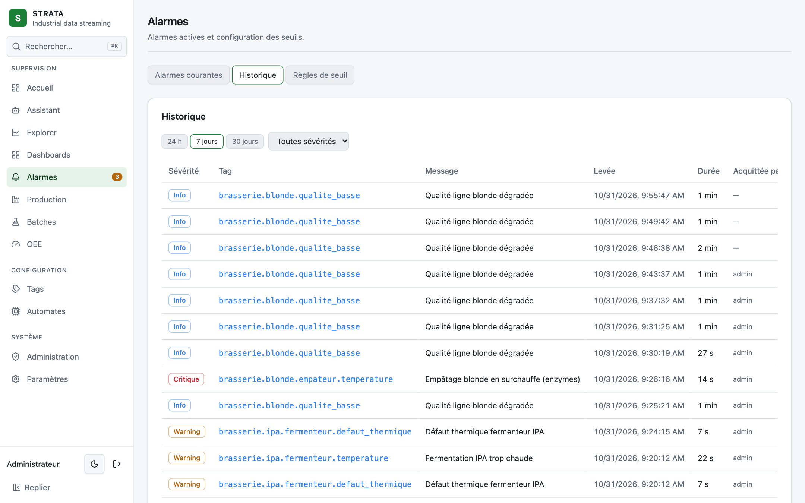
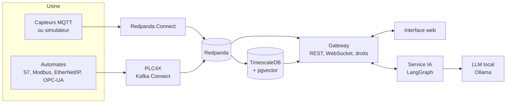

<h1 align="center">Strata</h1>

<p align="center">
  <strong>Vos machines parlent. Strata les écoute, les affiche et répond à vos questions.</strong><br>
  Supervision industrielle temps réel avec un assistant IA qui tourne chez vous, sans cloud.
</p>

<p align="center">
  <br>
  <sub>Vidéo accélérée pendant les temps de réponse de l'assistant.</sub>
</p>

## Ce que ça fait

Strata récupère les données de vos automates et capteurs, les centralise dans une seule base, et donne à chacun ce dont il a besoin : l'opérateur voit sa ligne en direct, le responsable de production suit son OEE, et tout le monde peut poser une question en français.

La démo tourne sur une micro-brasserie simulée : 3 lignes de production, des batches, des incidents et des défauts qualité.

- **Temps réel** : courbes en direct, historique, dashboards sauvegardés, export CSV.
- **Alarmes** : seuils, anti-rebond, acquittement, historique, notification immédiate.
- **Production** : OEE (disponibilité × performance × qualité), cascade des pertes, Pareto des arrêts, suivi par shift et par batch.
- **Pilotage** : démarrage et arrêt des lignes, consignes, avec des droits par ligne et un journal d'audit.
- **Configuration sans code** : automates, tags et connecteurs se gèrent depuis l'interface.

## L'assistant IA

Le modèle tourne sur votre machine : vos données et votre savoir-faire ne sortent pas de l'usine.

- **Il répond sur vos données** : « Quel est l'OEE de la ligne blonde ? », « Quelles sont les alarmes actives ? »
- **Il diagnostique** : « Pourquoi le dernier batch IPA est-il hors spec ? » Il croise les déviations de température, le nettoyage et les alarmes du batch, puis conclut sur un dossier complet.
- **Il connaît vos procédures** : il cherche dans vos PDF et affiche les passages consultés sous sa réponse, pour que l'opérateur puisse vérifier.
- **Il propose, vous décidez** : le modèle ne peut pas écrire sur un automate. Il choisit parmi des opérations prévues à l'avance, vous confirmez, puis le serveur revérifie vos droits et les règles métier. Par exemple, l'arrêt d'une ligne est refusé si un batch est en cours.

<p align="center">
  <picture>
    <source media="(prefers-color-scheme: dark)" srcset="docs/images/assistant-sombre.png">
    
  </picture>
</p>

## Captures

<table>
  <tr>
    <td width="50%">
      <picture>
        <source media="(prefers-color-scheme: dark)" srcset="docs/images/explorer-sombre.png">
        
      </picture>
      <p align="center"><em>Courbes en temps réel</em></p>
    </td>
    <td width="50%">
      <picture>
        <source media="(prefers-color-scheme: dark)" srcset="docs/images/oee-sombre.png">
        
      </picture>
      <p align="center"><em>OEE et cascade des pertes</em></p>
    </td>
  </tr>
  <tr>
    <td width="50%">
      <picture>
        <source media="(prefers-color-scheme: dark)" srcset="docs/images/batches-sombre.png">
        
      </picture>
      <p align="center"><em>Batches et verdicts qualité</em></p>
    </td>
    <td width="50%">
      <picture>
        <source media="(prefers-color-scheme: dark)" srcset="docs/images/alarmes-sombre.png">
        
      </picture>
      <p align="center"><em>Historique des alarmes</em></p>
    </td>
  </tr>
</table>

## Architecture



Deux principes structurent le projet :

- **Un seul format de données.** Quel que soit le protocole d'origine, tout arrive au même format, avec un nommage `site.ligne.machine.mesure`. Ajouter une source ne change rien au reste du système.
- **L'IA est un utilisateur comme un autre.** Elle n'a aucun accès direct à la base : elle passe par la même API que l'interface, avec authentification et journal d'audit.

## Stack technique

| Domaine | Technologies |
|---|---|
| **Streaming** | Redpanda (compatible Kafka), Redpanda Connect, MQTT (Mosquitto) |
| **Industriel** | Apache PLC4X via Kafka Connect, en option ; RisingWave pour le calcul temps réel, en option |
| **Base de données** | TimescaleDB (PostgreSQL), agrégats continus, compression et rétention |
| **Backend** | Node.js, TypeScript, Fastify, WebSocket |
| **Interface** | React, Vite, TypeScript, Tailwind, shadcn/ui, uPlot, assistant-ui |
| **IA** | Python, LangGraph, FastAPI, Ollama (`qwen3.5:9b`, `embeddinggemma`) |
| **Recherche documentaire** | Docling, pgvector, recherche hybride vecteurs + plein texte, reranker `bge-reranker-v2-m3` |
| **Qualité** | Évaluations automatisées de l'assistant, tests de contrat des outils, CI GitHub Actions |
| **Déploiement** | Docker Compose, launcher de bureau Tauri (Rust) |

## Essayer

Il faut Docker et Node.js, et compter environ 10 Go d'espace disque pour les modèles.

```bash
cp .env.example .env     # puis changez les mots de passe
make up-ai               # démarre tout, télécharge les modèles, indexe les manuels

cd web
npm install
npm run dev              # http://localhost:5173
```

Connectez-vous avec `admin` et le `ADMIN_PASSWORD` de votre `.env`. Le simulateur démarre tout seul : les courbes s'animent immédiatement, et l'OEE apparaît après une demi-heure environ, le temps que les premiers agrégats se calculent.

- **Première question à l'assistant :** comptez quelques minutes, le temps de télécharger le reranker. Il reste ensuite en cache.
- **Sur Mac :** Docker n'a pas accès au GPU. Installez [Ollama](https://ollama.com) nativement, téléchargez les deux modèles et décommentez `OLLAMA_URL` dans `.env`.
- **Sans l'assistant :** `make up` suffit.

## Reste à faire

- [ ] Tester les connecteurs sur de vrais automates : S7, Modbus et OPC-UA ne sont validés que sur simulateur à ce jour
- [ ] Appliquer les droits de l'opérateur connecté aux lectures de l'assistant et aux documents, qui passent aujourd'hui par un compte de service commun
- [ ] Évaluer automatiquement les réponses finales de l'assistant : le choix des outils et la recherche sont déjà mesurés
- [ ] Calculer l'OEE du shift en cours sur le temps écoulé, et non sur la durée totale du shift
- [ ] Conserver les conversations après un redémarrage du service IA
- [ ] Servir l'interface en production (build statique et reverse proxy), publier les images Docker
- [ ] Livrer le launcher en exécutable, et les modèles dans les images pour les sites sans internet
- [ ] Ajouter les synoptiques SCADA

## Pour aller plus loin

- [Architecture de l'infrastructure](docs/infra-architecture.md)
- [Référence technique du service IA](docs/ai-service-reference.md)
- [Choix de la stack](docs/adr/0001-choix-stack.md)
- [Roadmap détaillée](docs/roadmap.md)

## Adapter Strata à votre usine

Je m'appelle Mehdi Bouzit, je suis ingénieur data et IA en freelance. J'adapte Strata aux PME industrielles : connexion à vos automates, indicateurs de votre métier, assistant formé sur vos procédures, déploiement sur votre site.

**Contact :** [À COMPLÉTER : e-mail, LinkedIn, Malt]

## Licence

[MIT](LICENSE)
